# Capability hierarchy

This document shows the class hierarchy of every dapr4s capability trait and the traits related to it.
It is generated by hand from the current source code. **Keep it in sync with the code**: when you add, remove or
rename a capability member, update the matching diagram in the same commit.

Each building block has one **universal capability** `X` that takes the component name as an argument on every
method. Read-capable blocks split it into `X.ReadOnly` (reads only) and `X` (extends `X.ReadOnly`, adds writes).
`instance(name)` narrows a universal capability to one component and returns `X.Instance`; the override in `X`
is **covariant**: `X.ReadOnly.instance` returns `X.Instance.ReadOnly`, `X.instance` returns `X.Instance`. Every
`instance` result is captured by its receiver (`^{this}`; written `^this` in the diagrams). Each trait has a
companion object with **forwarders** (`(using cap: X)` twins of the trait methods), and each universal companion
has an `instance(name)` accessor that returns the narrowed capability (`Instance^{cap}`). Actor has two levels:
`ActorCapability.forType(actorType)` returns `ActorCapability.Type`, and `Type.instance(actorId)` returns
`ActorCapability.Instance`. In the diagrams, parameter default values and `JsonCodec` context bounds are not
shown; type parameters use Mermaid `~T~` notation.

The implementation classes (`*CapabilityUniversalImpl` for the universal capabilities and `*CapabilityImpl` for the
narrowed instances, plus `DaprCapabilityImpl`) live in `dapr4s.internal` and are not shown.

## Root

`DaprCapability` is the entry capability. It gets `jobs` and `conversation` from `DaprCapabilityPlatform`
(self-type `this: DaprCapability =>`). This document shows the JVM build only.

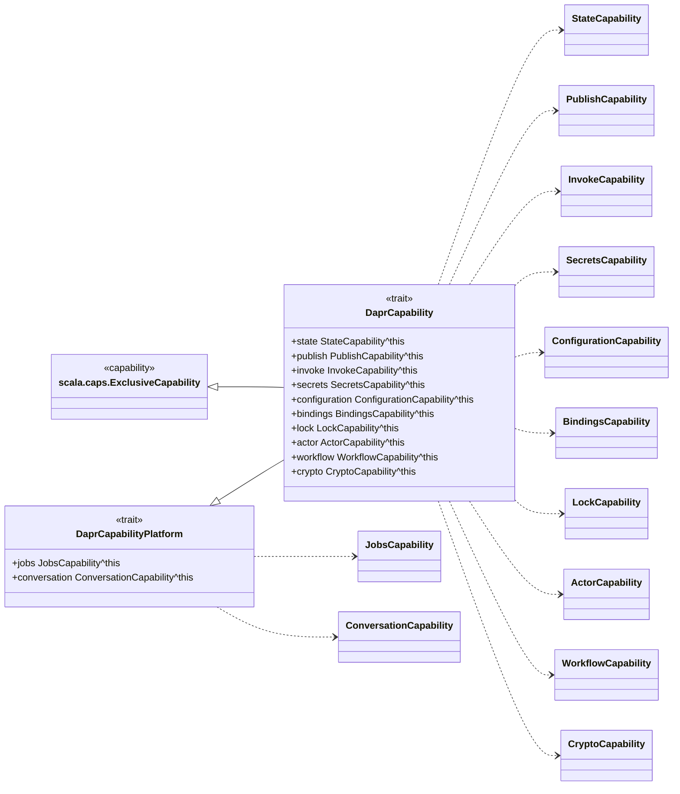

Companion `DaprCapability` (extends `DaprCapabilityCompanionPlatform`) has scoped forwarders that run a body with
the narrowed capability as a context parameter: `state(storeName)`, `publish(pubsubName)`, `invoke`,
`secrets(storeName)`, `configuration(storeName)`, `bindings(bindingName)`, `lock(storeName)`,
`actor(actorType, actorId)`, `workflow`, `crypto(componentName)`, `jobs`, `conversation(componentName)`.

## State

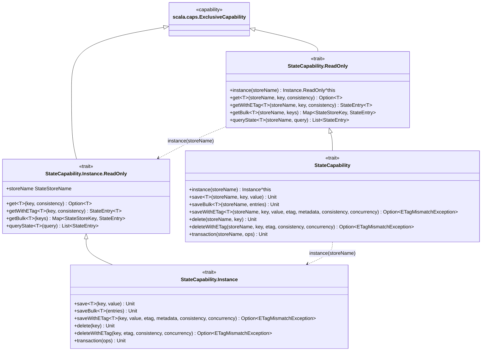

Companions: `StateCapability` (`instance(storeName)` + all read/write forwarders), `StateCapability.ReadOnly`
(`instance(storeName)` + read forwarders), `StateCapability.Instance` (all forwarders),
`StateCapability.Instance.ReadOnly` (read forwarders).

## Secrets

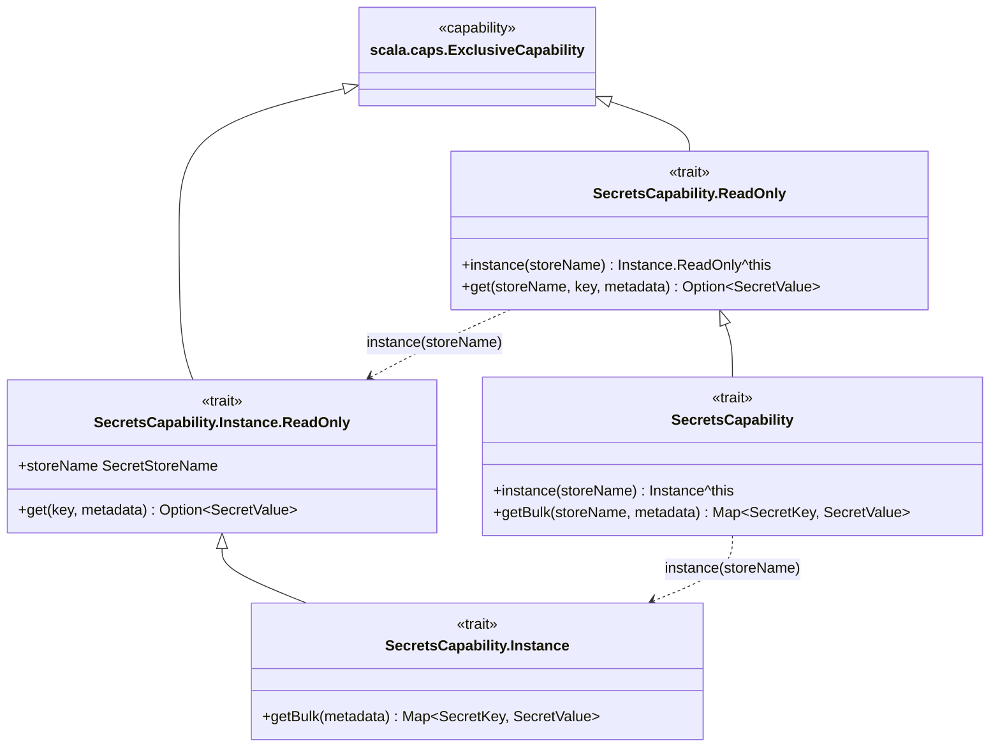

Companions: `SecretsCapability` (`instance(storeName)`, `get`, `getBulk`), `SecretsCapability.ReadOnly`
(`instance(storeName)`, `get`), `SecretsCapability.Instance` (`get`, `getBulk`),
`SecretsCapability.Instance.ReadOnly` (`get`).

## Configuration

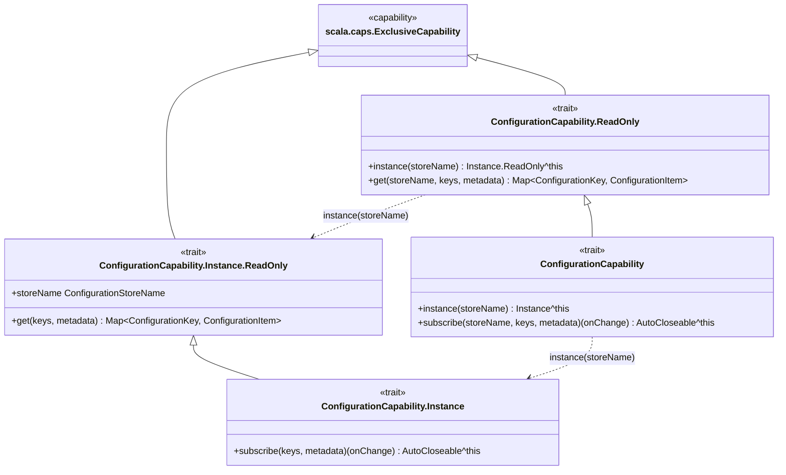

Companions: `ConfigurationCapability` (`instance(storeName)`, `get`, `subscribe`),
`ConfigurationCapability.ReadOnly` (`instance(storeName)`, `get`), `ConfigurationCapability.Instance` (`get`,
`subscribe`), `ConfigurationCapability.Instance.ReadOnly` (`get`).

## Jobs

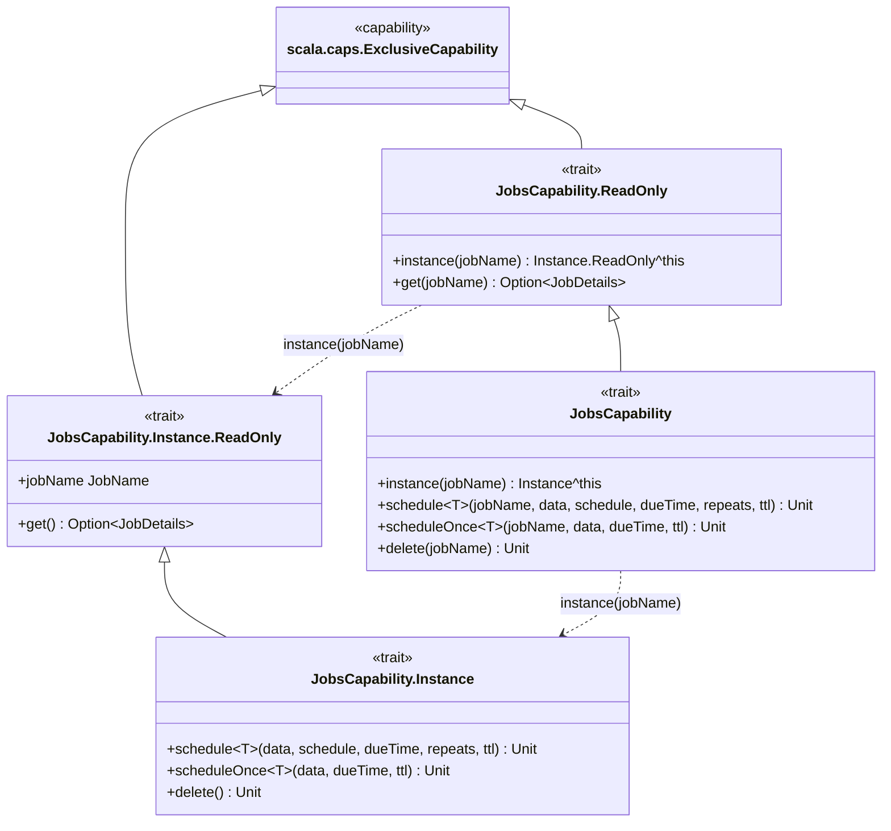

Companions: `JobsCapability` (`instance(jobName)`, `get`, `schedule`, `scheduleOnce`, `delete`),
`JobsCapability.ReadOnly` (`instance(jobName)`, `get`), `JobsCapability.Instance` (`get`, `schedule`,
`scheduleOnce`, `delete`), `JobsCapability.Instance.ReadOnly` (`get`).

## Workflow

The workflow client capability. The narrowing key is the workflow instance id, not a component name.

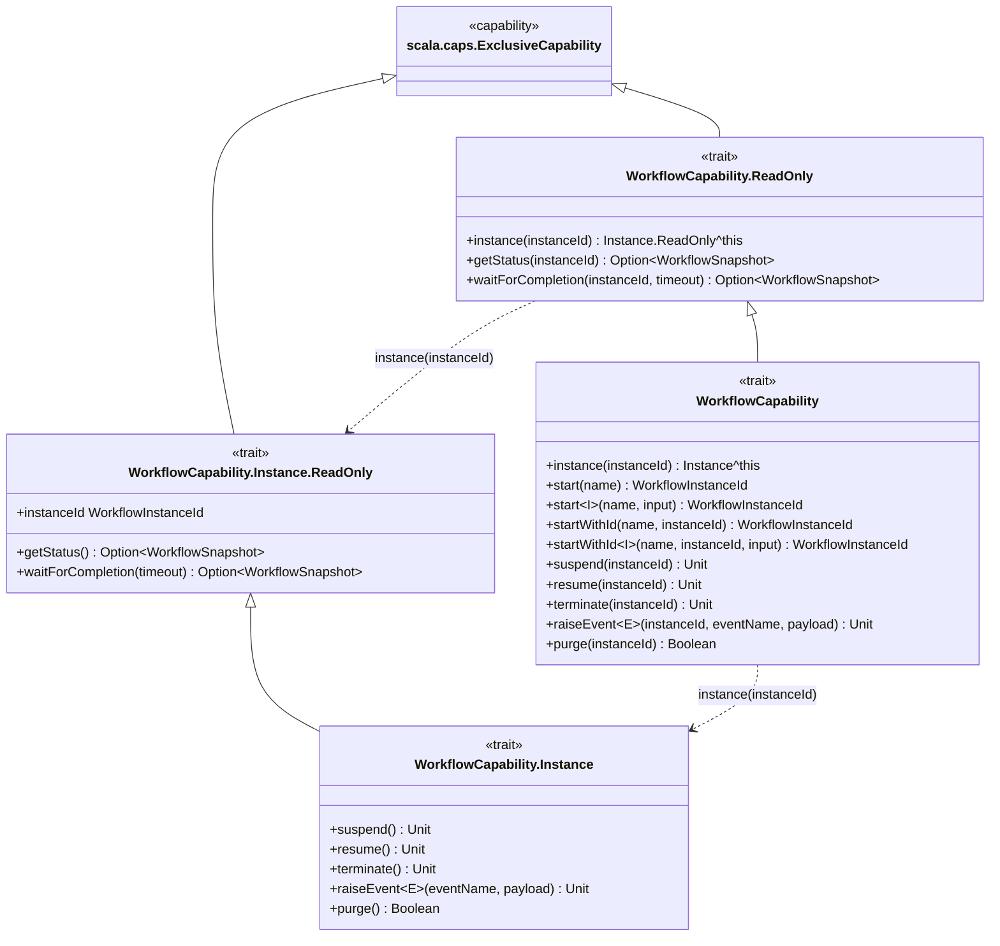

Companions: `WorkflowCapability` (`instance(instanceId)` + all forwarders), `WorkflowCapability.ReadOnly`
(`instance(instanceId)`, `getStatus`, `waitForCompletion`), `WorkflowCapability.Instance` (all forwarders),
`WorkflowCapability.Instance.ReadOnly` (`getStatus`, `waitForCompletion`).

## Publish

No read operations, so there is no `ReadOnly` split.

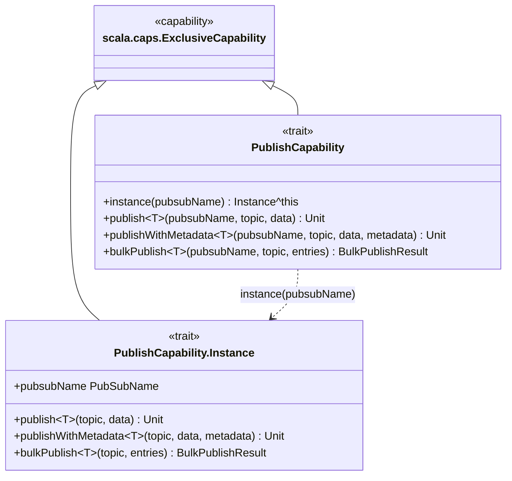

Companions: `PublishCapability` (`instance(pubsubName)`, `publish`, `publishWithMetadata`, `bulkPublish`),
`PublishCapability.Instance` (`publish`, `publishWithMetadata`, `bulkPublish`).

## Bindings

`invoke` uses clause interleaving: `invoke[Req](...)[Resp]`.

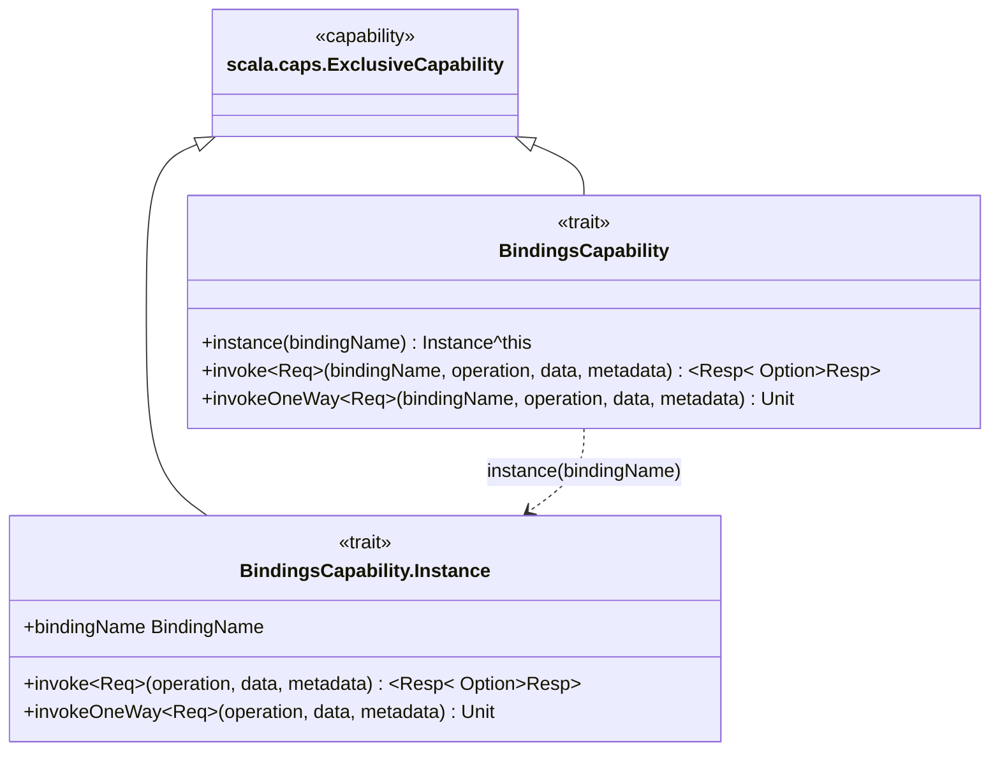

Companions: `BindingsCapability` (`instance(bindingName)`, `invoke`, `invokeOneWay`),
`BindingsCapability.Instance` (`invoke`, `invokeOneWay`).

## Lock

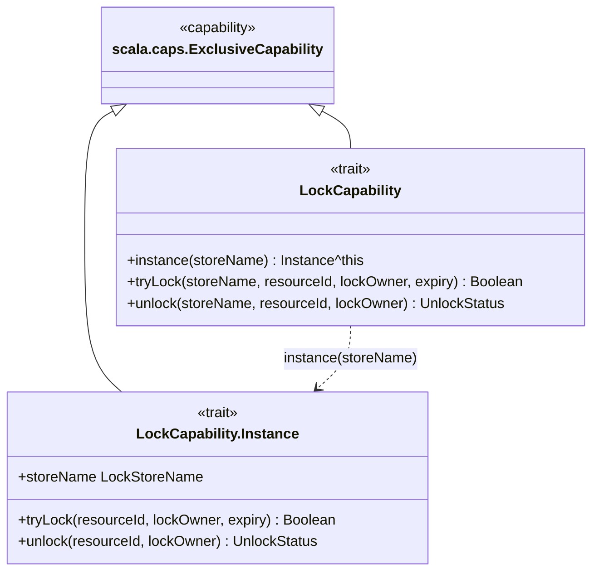

Companions: `LockCapability` (`instance(storeName)`, `tryLock`, `unlock`), `LockCapability.Instance` (`tryLock`,
`unlock`).

## Crypto

`encryptString` and `decryptString` are concrete methods on the traits (UTF-8 wrappers around `encrypt`/`decrypt`).

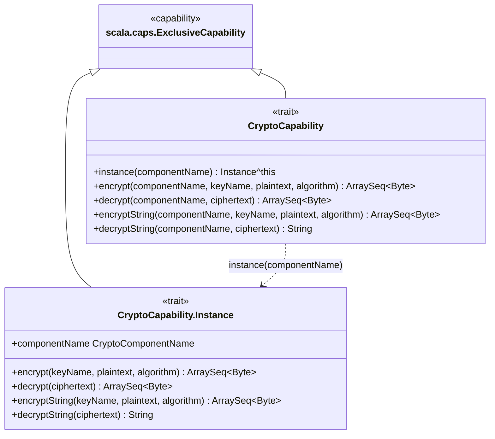

Companions: `CryptoCapability` (`instance(componentName)`, `encrypt`, `decrypt`, `encryptString`,
`decryptString`), `CryptoCapability.Instance` (`encrypt`, `decrypt`, `encryptString`, `decryptString`).

## Invoke

`invoke` uses clause interleaving: `invoke[Req](...)[Resp]`. The second overload sends no request body.

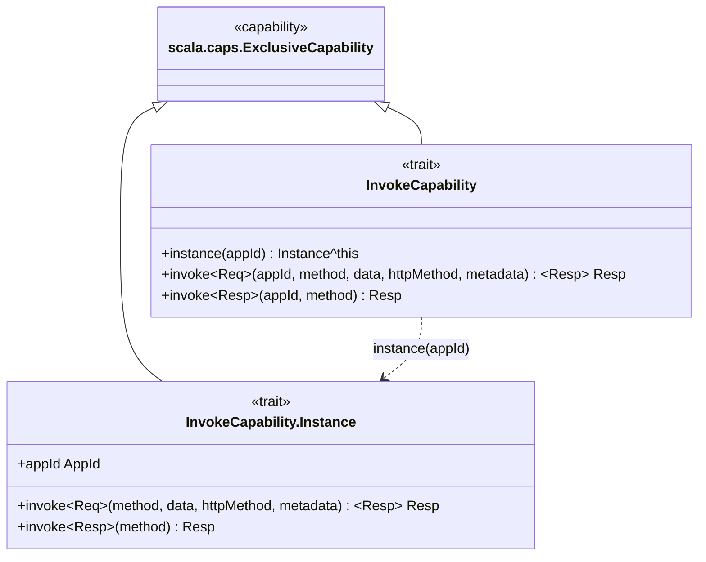

Companions: `InvokeCapability` (`instance(appId)`, both `invoke` overloads), `InvokeCapability.Instance` (both
`invoke` overloads).

## Conversation

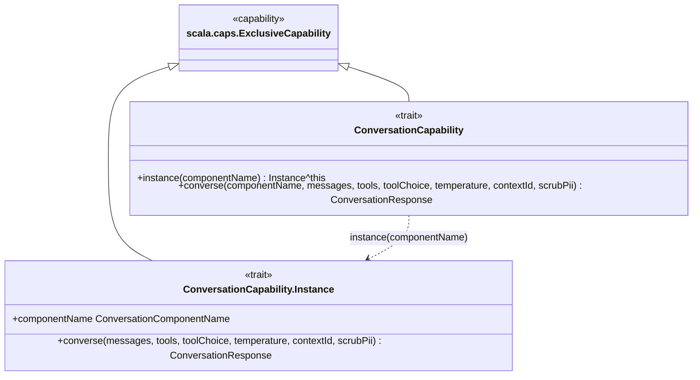

Companions: `ConversationCapability` (`instance(componentName)`, `converse`), `ConversationCapability.Instance`
(`converse`).

## Actor

Two narrowing levels: universal, then per actor type, then per actor instance. `invoke` uses clause interleaving.

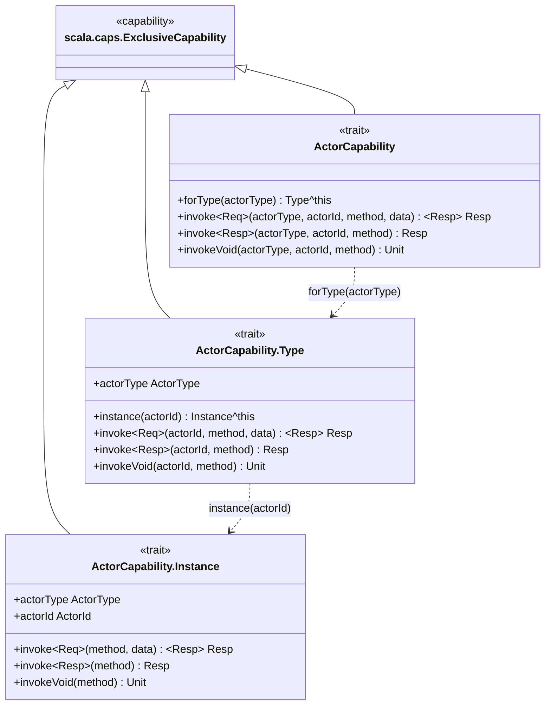

Companions: `ActorCapability` (`forType(actorType)` returns `Type^{cap}`, `instance(actorType, actorId)` returns
`Instance^{cap}`, plus `invoke` x2, `invokeVoid`), `ActorCapability.Type` (`instance(actorId)`, `invoke` x2,
`invokeVoid`), `ActorCapability.Instance` (`invoke` x2, `invokeVoid`).

## Server-side capabilities

These capabilities are not reached from `DaprCapability`. The runtime gives them to user code that runs inside a
Dapr callback (an actor method, a workflow run).

### Actor side: ActorContext and ActorState

`ActorContext` is the per-invocation actor capability (state access, reminders, timers). An `ActorDefinition` is
built from `ActorId => ActorContext ?=> ActorRoutes`. `ActorState` is not a trait: it is an object with the macro
`ActorState.derive[T]`, which implements a user field trait `T` on top of `ActorContext` (getter `x` maps to
`ctx.get(ActorStateKey("x"))`, setter `x_=` maps to `ctx.set(...)`).

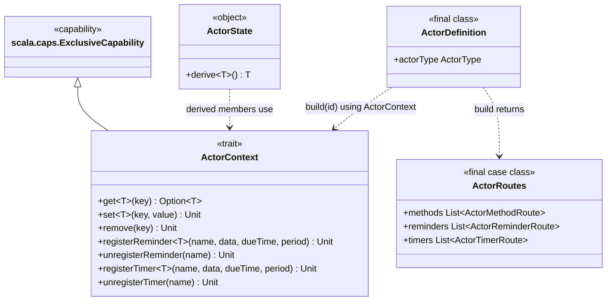

Companion `ActorContext`: forwarders for all seven members (`get`, `set`, `remove`, `registerReminder`,
`unregisterReminder`, `registerTimer`, `unregisterTimer`).

### Workflow side: WorkflowContext and related traits

`WorkflowContext` is the orchestration capability given to `Workflow.run`. The `Task` values it returns are
captured by it (`Task[...]^{this}`), so a task cannot outlive the workflow run. `WorkflowActivity.execute` gets a
full `DaprCapability` instead. `ActivityDef[A]` is the type class (derived for every `WorkflowActivity` subclass)
that types `callActivity`.

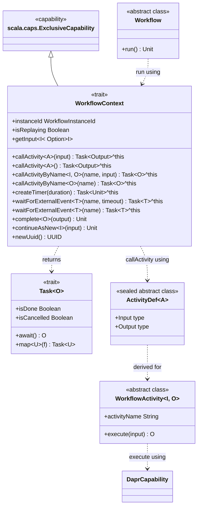

Companion `WorkflowContext`: forwarders for every member (`instanceId`, `isReplaying`, `getInput`, `callActivity`
x2, `callActivityByName` x2, `createTimer`, `waitForExternalEvent` x2, `complete`, `continueAsNew`, `newUuid`).
