# dapr4s — Capability Splitting (Design Exploration)

**Status:** design exploration, now **implemented in a revised form — see [§11](#11-the-implemented-design--universal-capability--instance--readonly-tiers)** for the live API (a universal capability per family, plus `Instance` and, for State/Secrets/Configuration/Jobs/Workflow, `ReadOnly` tiers). §1–§10 are kept as the historical exploration. Their type names (`Access*Capability`, `ReadState`, `WorkflowInstanceCapability`, `JobCapability`, …) are not the live API.
**Scope:** how each DAPR capability trait *could* be subdivided into narrower capabilities, why, and the cost.
**Audience:** anyone evolving the public capability surface — the per-family `*Capability.scala` files in `src/shared/<family>/` (`dapr4s.<family>` packages) and the JVM-only `src/jvm/jobs/JobsCapability.scala` / `src/jvm/conversation/ConversationCapability.scala`.

This document follows the question "*`DaprCapability#state` hands out a `StateCapability` bound to one store — what else can be split that way?*" to its conclusion across the whole API.

---

## 1. The two axes of splitting

"Splitting like state" is not one operation — it is **two**, along orthogonal axes. Keeping them apart is what makes the rest of this document tractable.

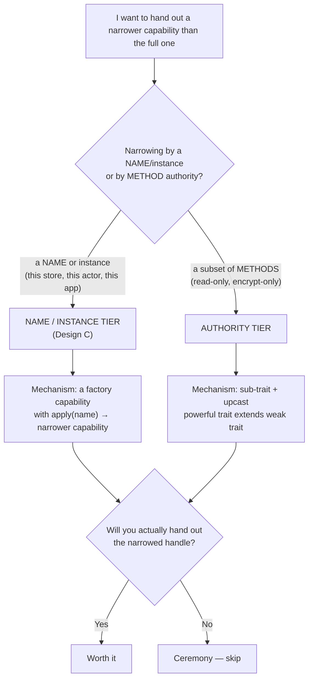

| | **Name / instance tier** | **Authority tier** |
|---|---|---|
| What is removed | a *name argument* (it gets baked into the handle) | a *set of methods* |
| Mechanism | intermediate **factory** capability (`apply(name)`) | **trait subtyping** (`Powerful extends Weak`) — attenuate by upcast |
| New runtime object? | yes (one per name) | **no** — same instance, narrower static type |
| Capture set of result | `^{parent}`, transitively rooted in `dapr` — no lifetime change | identical `^{c}` — no lifetime change |
| Example today | `state(storeName): StateCapability` | none yet |

The single most useful realisation from the research: **authority tiers are nearly free**. If `StateCapability extends ReadState`, then a `StateCapability^{c}` already *is a* `ReadState^{c}`; you attenuate by upcasting — no factory, no extra allocation, same capture set. Only the *name tiers* need the Design-C factory machinery.

---

## 2. The two mechanisms, side by side

### 2a. Authority tier = sub-trait + upcast

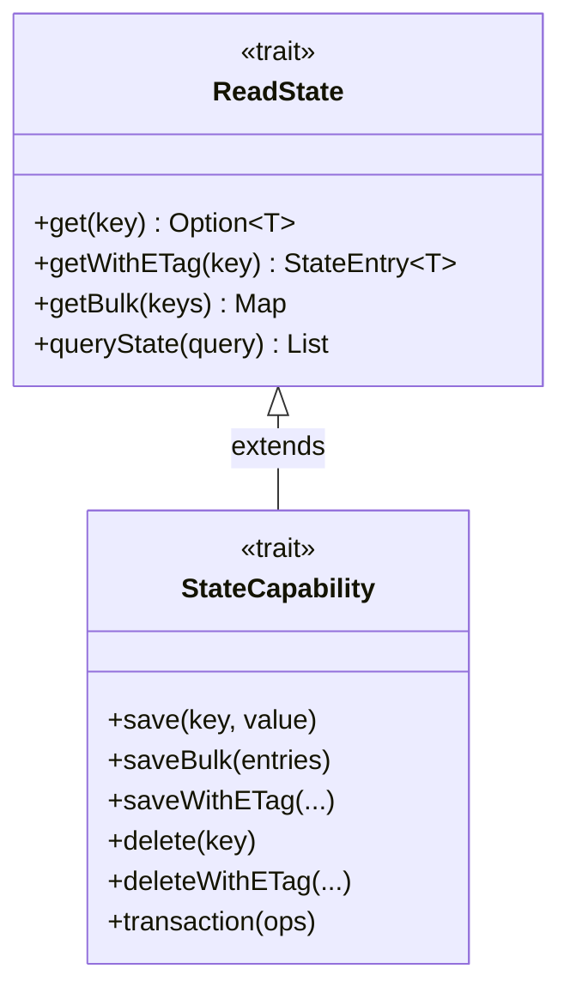

`dapr.state(name)` still returns the full `StateCapability`. A query/read handler is declared to take `ReadState^` — and the full capability passes by ordinary subsumption. The read handler *cannot* name `save`/`delete`/`transaction` because its static type has no such members.

### 2b. Name / instance tier = Design-C factory

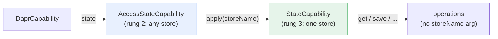

These compose: a capability can have **both** a name tier (downward) *and* authority tiers (sideways).

### 2c. How attenuation is actually used (and what it does/doesn't guarantee)

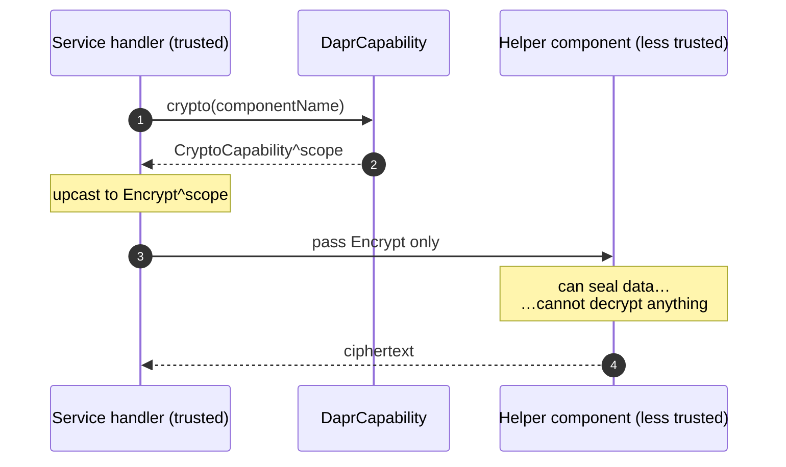

> **Enforcement boundary.** These splits are enforced by the **interface** — the narrow type physically lacks the dangerous method. Capture checking enforces only *region/lifetime* (the handle can't outlive `Dapr.run`). It does **not** enforce the authority narrowing; an `@assumeSafe` cast back to the wide type would defeat it. So this is object-capability attenuation, documented and structurally enforced in normal code, not a CC theorem.

---

## 3. The whole surface at a glance

Every capability and the seam(s) the research found in it:

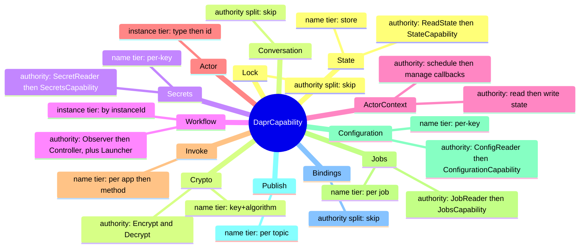

---

## 4. Ranking: payoff vs cost

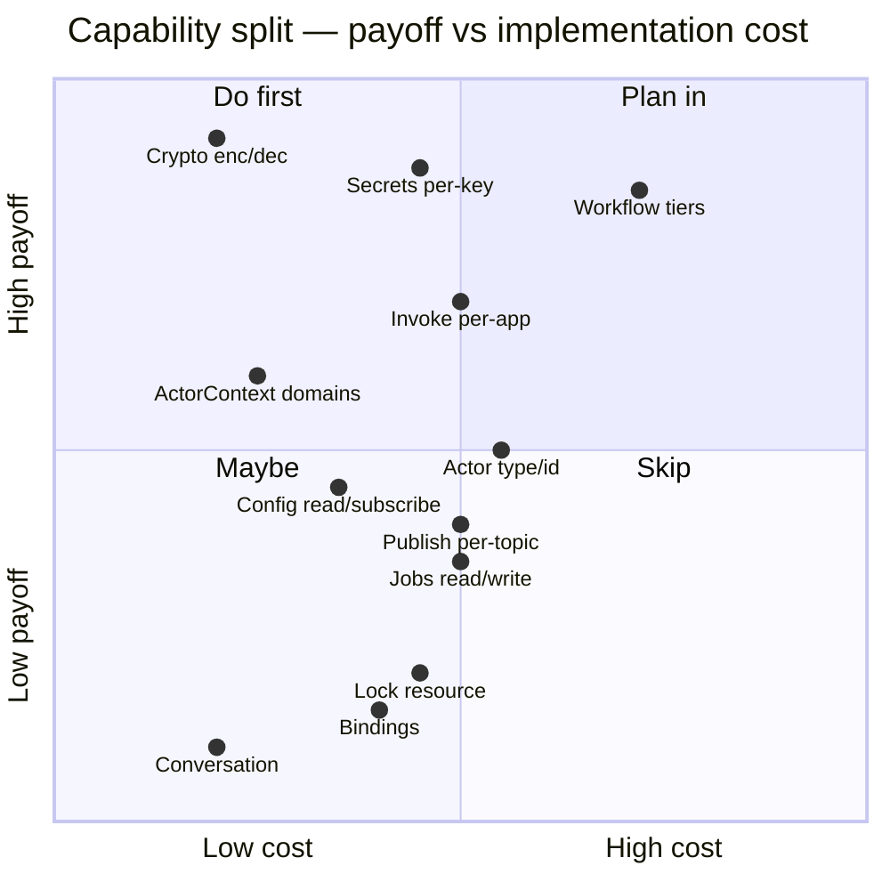

---

## 5. Per-capability designs

### 🥇 5.1 Crypto — encrypt vs decrypt (asymmetric authority)

`encrypt(keyName, plaintext, algorithm)` and `decrypt(ciphertext)` are independent authorities fused into one trait — the sealing/opening analog of sign/verify. A component that only emits sealed data should never be able to open anything.

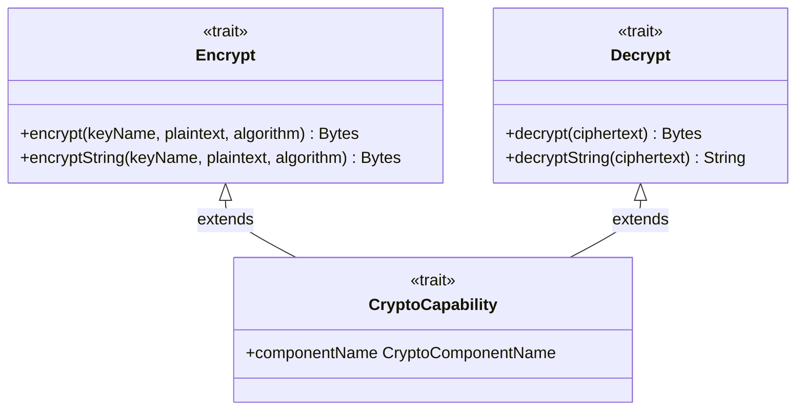

- **Authority tier** (sub-trait + upcast): `Encrypt` ⊕ `Decrypt`, with `CryptoCapability extends both`.
- **Bonus name tier:** `encrypt` carries `keyName` + `algorithm`, so a Design-C sub-tier `crypto(component).key(keyName, algorithm)` yields a "seal with exactly this key" handle.
- **Verdict:** highest payoff, lowest cost. Real security meaning, pure subtyping.

### 🥇 5.2 Secrets — get(key) vs getBulk (privilege escalation hiding as a sibling)

`getBulk` reads **every secret in the store**; `get(key)` reads one. Today the same handle grants both.

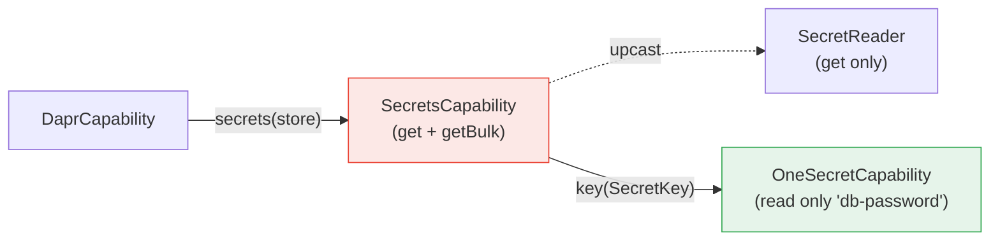

- **Authority tier:** separate `getBulk` (read-all) from per-key `get`.
- **Name tier (stronger):** `secrets(store).key(SecretKey)` → "may read only this one secret". Secrets are the most sensitive surface in the library; this is arguably the single most valuable attenuation here.
- **Verdict:** do it.

### 🥇 5.3 Workflow — launch / observe / control + instance tier (richest target)

Eleven methods cluster cleanly by authority, and ten of them take a `WorkflowInstanceId` (a collapsed instance tier the companion already exposes as `id.suspend()` extensions).

State machine of an instance, annotated by which authority tier drives each edge:

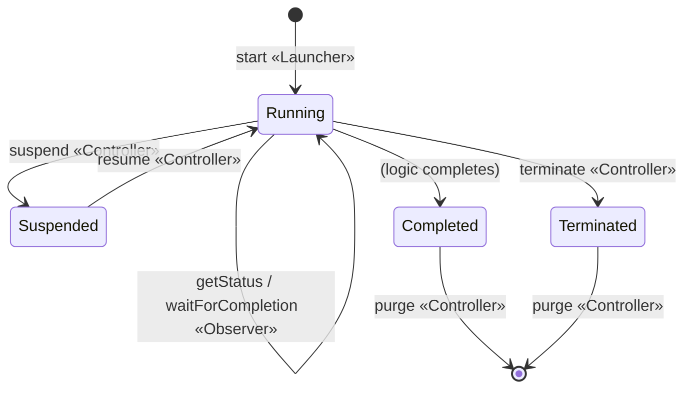

Authority tiers:

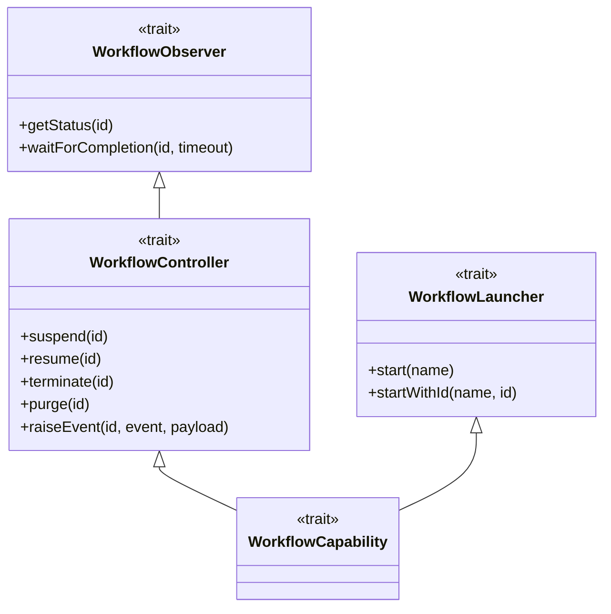

Read-only `WorkflowObserver` is the base; `WorkflowController` **extends** it (you can't control an instance you can't observe), so a "monitor only" grant is `WorkflowObserver` and a "manage existing instances" grant is `WorkflowController`. `WorkflowLauncher` (`start*`) is orthogonal — minting instances is a separate authority — and `WorkflowCapability` extends both leaves.

Instance tier (Design C), folding away the repeated `instanceId` argument:

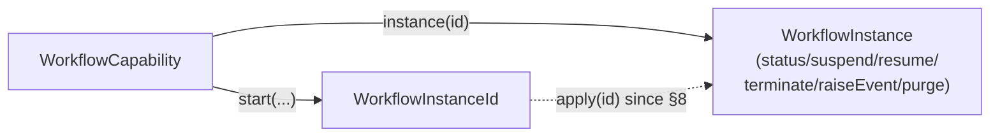

> **Note — the `WorkflowInstanceId` extension methods (historical).** Before §8 the companion exposed the instance ops as fluent extensions on `WorkflowInstanceId` (`id.suspend()`, …), each taking a `using WorkflowCapability`, which would silently re-demand the full capability under this split. §8 made them methods on `WorkflowInstanceCapability` (reached via `apply(id)`), and the extensions were then removed so there is one spelling (§10.3).

- **Verdict:** biggest API win. Read-only observation separates cleanly from control, and isolating destructive `terminate`/`purge` from "kick off a workflow" code is worth it; the instance grouping already half-exists.

### 🥈 5.4 ActorContext — read-state / schedule / cancel

The source partitions the trait by `--- State ---`, `--- Reminders ---`, `--- Timers ---` banners, but those banners are *not* the best authority seams. The reminder-vs-timer banner is a persistence detail (persistent vs non-persistent), not a privilege boundary — and you rarely want "may touch reminders but not timers". The privilege boundaries that matter are **read vs the rest of state**, and **scheduling a callback vs cancelling one** — and the latter cuts *across* both reminders and timers. So the split groups by verb, not by reminder/timer:

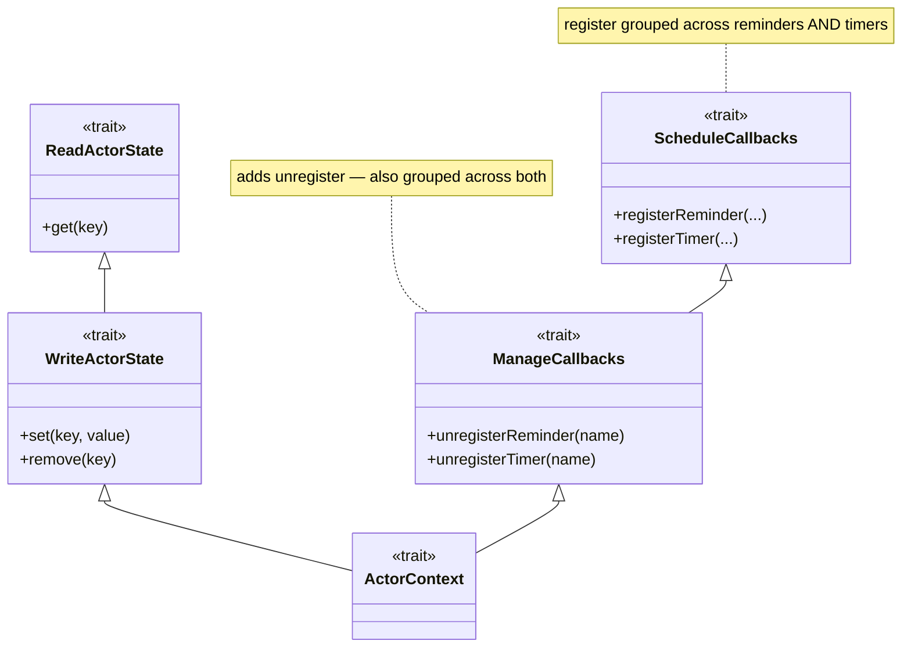

Two linear lineages, each read/light → mutating/heavy: `ReadActorState` → `WriteActorState` (adds `set`/`remove`), and `ScheduleCallbacks` → `ManageCallbacks` (adds `unregister*`). `ActorContext` extends the two leaves. `ManageCallbacks` is the renamed `CancelCallbacks` — since it extends `ScheduleCallbacks` it carries both register and unregister, so "manage" reads better than "cancel".

- **Verdict:** cheap (pure subtyping), medium payoff. `ReadActorState` is the valuable read-only grant; the lineages let you grant "read+write state but no callbacks", or "schedule callbacks but not cancel them", uniformly across reminders and timers.

### 🥈 5.5 Actor — type then id (a collapsed instance tier)

`actor(actorType, actorId)` is a **two-name factory** that flattens a natural Design-C tier.

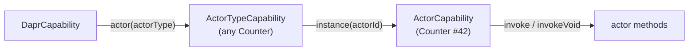

- **Verdict:** mirrors the state design exactly; useful for "this actor type only" grants or code addressing many instances of one type.

### 🥈 5.6 Invoke — per-target attenuation (the inverse of state)

`InvokeCapability` is a single shared handle (Design B — `appId`+`method` per call). Anyone holding it can RPC **any** app.

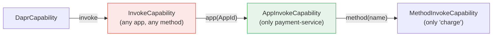

- **Verdict:** the service-to-service least-privilege story. Invoke *lacks* the tier state *has*; adding a downward `app(...)` tier is the symmetric fix.

### 🥉 5.7 Jobs — currently "Design B", plus read/write

`schedule` / `scheduleOnce` / `get` / `delete` all take a `JobName` per call. Two independent splits — a name tier and the read-only-base authority split:

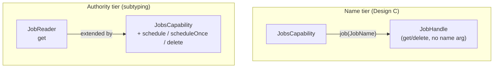

Per the read-only-base rule, only `JobReader` (`get`) is extracted; the mutating `schedule` / `scheduleOnce` / `delete` stay on `JobsCapability` (no separate `JobScheduler` / `JobAdmin`).

- **Verdict:** modest payoff; the read-only `JobReader` grant is the main draw.

### 🥉 5.8 Configuration — read vs subscribe

`get(keys)` is a one-shot read; `subscribe(keys)(onChange)` opens a **long-lived stream**, returns `AutoCloseable^{this}`, and is the *only* callback capability in the library.

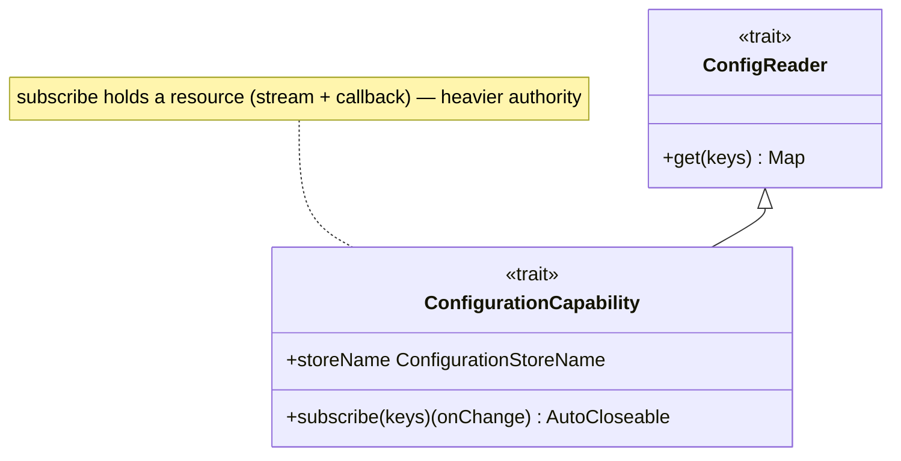

- **Verdict:** isolates the resource-holding streaming authority from plain reads. Reasonable; add per-key name tier if demand exists.

### 🥉 5.9 Publish — per-topic tier

All three methods are writes (no read/write seam), but `topic` is a routing dimension worth attenuating.

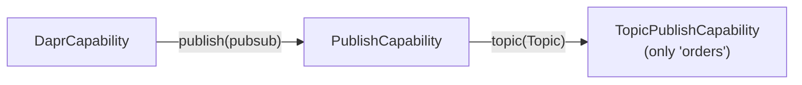

- **Verdict:** meaningful "publish only to topic X" grant; mirrors state→key.

### 5.10 Weak / skip

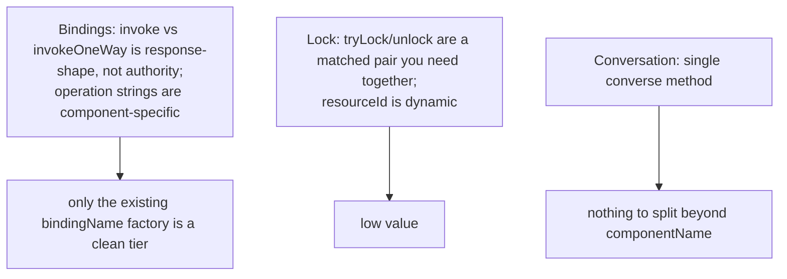

---

## 6. Cross-cutting: activities and actors get the *whole* capability

`WorkflowActivity.execute(input)(using DaprCapability)` and actor `build` lambdas receive the **entire** `DaprCapability`. None of the trait splits above help here — the lever is handing those callbacks a *narrowed* capability (only the sub-capabilities they declare). This is a separate, larger design question and is called out so it isn't mistaken for something the per-trait splits solve.

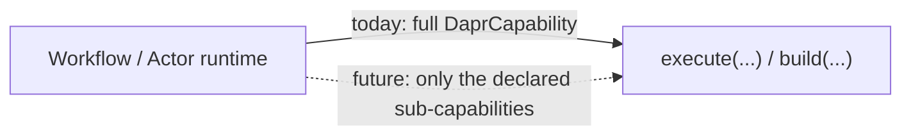

---

## 7. Recommendation & sequencing

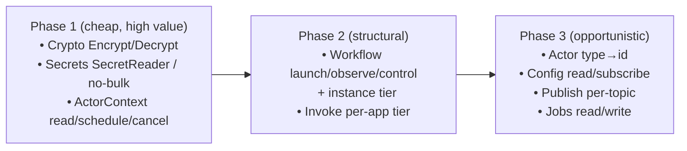

**Rules of thumb that fell out of the research:**

1. **Authority tiers first** — they are sub-trait + upcast: no new objects, no capture-set change, no factory plumbing.
2. **Name tiers only where you will hand out the narrowed handle** — otherwise the intermediate capability is pure ceremony (`dapr.state(name)` stays terser than `dapr.state.apply(name)` if nobody ever passes a bare rung-2 handle around). Where you do add one, name the selector `apply` so `dapr.state(name).get(key)` reads unchanged while `dapr.state` becomes the passable rung-2 capability.
3. **Prioritise by what's dangerous to over-grant**, not by symmetry: decrypt, read-all-secrets, terminate/purge, arbitrary-app RPC.

---

## 8. Worked example — "Design C" applied to *every* capability

**Status: superseded by [§11](#11-the-implemented-design--universal-capability--instance--readonly-tiers).** This shape was implemented for a while (argument-less accessors on `DaprCapability` returning `Access*Capability` rung-2 traits). The live API has since merged rung 2 into a universal capability that also takes the name on each method, and renamed rung 3 to `X.Instance` — see §11.3. The per-family packages (`dapr4s.state`, `dapr4s.invoke`, …) introduced with it remain. The text below is kept as history.

This section shows the concrete shape of the new capabilities if the name/instance tier were applied uniformly. The rule is mechanical:

> Every `def x(name: N): XCapability` on `DaprCapability` becomes `def x: AccessXCapability` (no argument), and the name moves to `AccessXCapability#apply(name): XCapability`. Where a capability carries the name on its *methods* today (invoke, jobs, workflow instances), that name is lifted out the same way.

So the root shrinks to a set of **argument-less accessors**:

```mermaid
flowchart LR
    D["DaprCapability"]
    D --> AS["AccessStateCapability"]
    D --> AP["AccessPublishCapability"]
    D --> AI["AccessInvokeCapability"]
    D --> ASe["AccessSecretsCapability"]
    D --> AC["AccessConfigurationCapability"]
    D --> AB["AccessBindingsCapability"]
    D --> AL["AccessLockCapability"]
    D --> AA["AccessActorCapability"]
    D --> AW["AccessWorkflowCapability"]
    D --> ACr["AccessCryptoCapability"]
    D --> AJ["AccessJobsCapability (JVM)"]
    D --> ACo["AccessConversationCapability (JVM)"]
```

### 8.1 The uniform pattern

Every accessor is the same two-trait shape. Shown generically, then instantiated for state:

```mermaid
classDiagram
    class AccessXCapability {
        <<trait>>
        +apply(name: N) X
    }
    class XCapability {
        <<trait>>
        +name: N
        +op1(...)
        +op2(...)
    }
    AccessXCapability ..> XCapability : "apply returns (rung 3)"
    note for AccessXCapability "rung 2 — 'any X' — argument-less; held and passed around"
    note for XCapability "rung 3 — 'this X' — methods never mention N"
```

```mermaid
classDiagram
    class AccessStateCapability {
        <<trait>>
        +apply(storeName: StateStoreName) StateCapability
    }
    class StateCapability {
        <<trait>>
        +storeName: StateStoreName
        +get(key, consistency) Option~T~
        +save(key, value)
        +transaction(ops)
        +queryState(query) List
    }
    AccessStateCapability ..> StateCapability
```

**Key point:** for the eight capabilities that already take the name in the factory (state, publish, secrets, configuration, bindings, lock, crypto, conversation), **rung 3 is today's trait, unchanged** — only the rung-2 `Access*` trait is new. `dapr.state(name)` keeps reading identically because `apply` is invoked with the same argument list; the gain is that `dapr.state` is now itself a passable "any store" handle.

### 8.2 The three capabilities whose methods lose an argument

For these, the name lives on the methods today, so uniform Design C changes rung 3 too — every method drops the lifted name.

```mermaid
classDiagram
    class AccessInvokeCapability {
        <<trait>>
        +apply(appId: AppId) InvokeCapability
    }
    class InvokeCapability {
        <<trait>>
        +appId: AppId
        +invoke(method, data, httpMethod, metadata) Resp
        +invoke(method) Resp
    }
    AccessInvokeCapability ..> InvokeCapability
    note for InvokeCapability "appId dropped from every method"
```

```mermaid
classDiagram
    class AccessJobsCapability {
        <<trait>>
        +apply(name: JobName) JobCapability
    }
    class JobCapability {
        <<trait>>
        +jobName: JobName
        +schedule(data, schedule, dueTime, repeats, ttl)
        +scheduleOnce(data, dueTime, ttl)
        +get() Option~JobDetails~
        +delete()
    }
    AccessJobsCapability ..> JobCapability
    note for JobCapability "JobName dropped from every method"
```

Workflow is the interesting one: `start*` *mints* the instance id, so the accessor keeps the launch methods, and `apply(id)` hands back an instance-scoped capability holding the id-less operations.

```mermaid
classDiagram
    class AccessWorkflowCapability {
        <<trait>>
        +start(name) WorkflowInstanceId
        +startWithId(name, id) WorkflowInstanceId
        +apply(id: WorkflowInstanceId) WorkflowInstanceCapability
    }
    class WorkflowInstanceCapability {
        <<trait>>
        +instanceId: WorkflowInstanceId
        +getStatus() Option~WorkflowSnapshot~
        +suspend()
        +resume()
        +terminate()
        +raiseEvent(event, payload)
        +waitForCompletion(timeout) Option~WorkflowSnapshot~
        +purge() Boolean
    }
    AccessWorkflowCapability ..> WorkflowInstanceCapability
```

### 8.3 Actor — two names, two tiers

The actor accessor is the only one that descends **two** rungs (`ActorType` then `ActorId`), each an `apply`:

```mermaid
flowchart LR
    D["DaprCapability"] -->|".actor"| AA["AccessActorCapability"]
    AA -->|"apply(actorType)"| AT["ActorTypeCapability<br/>(val actorType)"]
    AT -->|"apply(actorId)"| AC["ActorCapability<br/>(val actorType, val actorId)<br/>invoke / invokeVoid — no type/id args"]
```

### 8.4 Full mapping

| Capability | rung 2 (new) | `apply` arg(s) | rung 3 | rung-3 methods change? |
|---|---|---|---|---|
| state | `AccessStateCapability` | `StateStoreName` | `StateCapability` | no |
| publish | `AccessPublishCapability` | `PubSubName` | `PublishCapability` | no |
| secrets | `AccessSecretsCapability` | `SecretStoreName` | `SecretsCapability` | no |
| configuration | `AccessConfigurationCapability` | `ConfigurationStoreName` | `ConfigurationCapability` | no |
| bindings | `AccessBindingsCapability` | `BindingName` | `BindingsCapability` | no |
| lock | `AccessLockCapability` | `LockStoreName` | `LockCapability` | no |
| crypto | `AccessCryptoCapability` | `CryptoComponentName` | `CryptoCapability` | no |
| conversation | `AccessConversationCapability` | `ConversationComponentName` | `ConversationCapability` | no |
| invoke | `AccessInvokeCapability` | `AppId` | `InvokeCapability` | **yes** — drop `appId` |
| jobs | `AccessJobsCapability` | `JobName` | `JobCapability` | **yes** — drop `JobName` |
| workflow | `AccessWorkflowCapability` (+`start*`) | `WorkflowInstanceId` | `WorkflowInstanceCapability` | **yes** — drop `instanceId` |
| actor | `AccessActorCapability` | `ActorType` → `ActorId` | `ActorCapability` (via `ActorTypeCapability`) | **yes** — drop type/id |

> Note: `ActorContext` and `WorkflowContext` are framework-provided (not acquired from `DaprCapability`), so the root-level Design C does not reach them. Their internal name args (`ActorStateKey`, `ReminderName`, `EventName`…) could be lifted analogously, but that's a separate, lower-value move.

---

## 9. Worked example — the "authority split" applied to *every* capability

Here the mechanism is **trait subtyping**: define narrow sub-traits, and let the full capability `extend` all of them. No factory, no new runtime object, identical `^{c}` capture set — you attenuate by *upcasting* to a sub-trait. The diagrams below show the new sub-traits each capability would gain.

**Guiding principle — the line is read-only vs everything-else.** The one seam worth drawing in almost every capability is between **read-only** operations and **anything that creates, changes, or deletes**. So the base sub-trait is the read-only view, and the concrete capability extends it with the mutating methods (`ReadState <|-- StateCapability`, `JobReader <|-- JobsCapability`, `WorkflowInfo <|-- WorkflowContext`, …). Two riders on top of that:

1. **A finer read/read split is kept only where one read is far more powerful than another** — `SecretReader.get(key)` vs `SecretsCapability.getBulk` (reads *every* secret), and `ConfigReader.get` vs `ConfigurationCapability.subscribe` (opens a live stream). Both sides are read-only, but the broad read is worth denying on its own, so the narrow reader is extracted.
2. **The mutating side may form a linear lineage** rather than a flat set, when one mutating authority naturally subsumes another — e.g. callback *management* extends callback *scheduling*, and workflow *control* extends workflow *observation*.

**Naming.** The concrete, most-powerful trait keeps its original `*Capability` / `*Context` name (`StateCapability`, `CryptoCapability`, `ActorContext`, …). The *new* narrow sub-traits drop that suffix — `ReadState`, `Encrypt`, `SecretReader`, `ScheduleCallbacks`. The suffix marks "the full thing you acquire"; a sub-trait is an attenuated view, not a thing you acquire directly. A consequence of the read-only-base rule: there is a `ReadState` but no `WriteState` — the write methods simply stay on the concrete `StateCapability` rather than getting an inverse "write-only" trait that nobody can use without reads anyway (see the per-capability notes).

### 9.1 The capabilities with a clean authority axis

```mermaid
classDiagram
    direction LR
    class ReadState {
        <<trait>>
        +get() +getWithETag() +getBulk() +queryState()
    }
    class StateCapability {
        <<trait>>
        +save() +saveBulk() +saveWithETag()
        +delete() +deleteWithETag() +transaction()
    }
    ReadState <|-- StateCapability
    note for ReadState "reads only — no transaction (see below)"
```

**Why no `transaction` on `ReadState`?** You asked whether `ReadState` could carry a read-only `transaction`. It can't be backed by anything: Dapr's transactional API batches **writes only** — a `StateOp` is an upsert or a delete; there is no read operation type to put in a transaction. Consistent multi-key reads are already served by `getBulk`, which is on `ReadState`. So `ReadState` = `get` / `getWithETag` / `getBulk` / `queryState`, and `transaction` lives only on the full `StateCapability`.

**Why no `WriteState`?** Read-only has obvious value; write-only is weaker. Pros and cons of minting a separate `WriteState`:

| | |
|---|---|
| **Pros** | Models a genuine "blind sink" — an append-only audit/event writer that should never read back. Defends against exfiltration (can't read what it can't read). Symmetry. |
| **Cons** | Most writes *need* a prior read: `saveWithETag`/`deleteWithETag` consume an ETag obtained from `get`/`getWithETag`, so optimistic-concurrency flows can't use a write-only handle. `getBulk`/`queryState` are reads too. The only fully write-only path is blind `save`/`delete`/`transaction`, which is a narrow niche. So the trait would rarely be the right grant, and "leftover-of-ReadState" isn't independently compelling. |

**Decision:** keep `ReadState`; **do not** add `WriteState` — the write methods stay on `StateCapability`. (If a real blind-writer consumer ever appears, `WriteState` is a cheap additive sub-trait at that point.)

```mermaid
classDiagram
    direction LR
    class Encrypt {
        <<trait>>
        +encrypt() +encryptString()
    }
    class Decrypt {
        <<trait>>
        +decrypt() +decryptString()
    }
    class CryptoCapability
    Encrypt <|-- CryptoCapability
    Decrypt <|-- CryptoCapability
```

```mermaid
classDiagram
    direction LR
    class SecretReader {
        <<trait>>
        +get(key) Option~SecretValue~
    }
    class SecretsCapability {
        <<trait>>
        +getBulk() Map
    }
    SecretReader <|-- SecretsCapability
    note for SecretsCapability "getBulk reads ALL secrets — the dangerous one; stays here"
```

**No `BulkSecretReader`.** You asked whether `getBulk` can just live on `SecretsCapability` — yes, and it should. `getBulk` (read every secret in the store) is the *high-authority* method, so it belongs on the full capability; the only sub-trait worth extracting is the safe `SecretReader` (single-key `get`). Attenuating to `SecretReader` is exactly how you deny bulk reads. A `BulkSecretReader` trait would be the inverse leftover — no standalone value — so it isn't created. (Same shape as `ReadState`: extract the safe view, leave the powerful method on the concrete.)

```mermaid
classDiagram
    direction LR
    class ConfigReader {
        <<trait>>
        +get(keys) Map
    }
    class ConfigurationCapability {
        <<trait>>
        +subscribe(keys)(onChange) AutoCloseable
    }
    ConfigReader <|-- ConfigurationCapability
    note for ConfigurationCapability "subscribe opens a stream + callback — heavier; stays here"
```

Same shape again: `subscribe` (the heavier, resource-holding, stream-opening method) stays on `ConfigurationCapability`; only the plain `ConfigReader` (`get`) is extracted, since "may read config but not open live subscriptions" is the valuable narrow grant.

```mermaid
classDiagram
    direction LR
    class WorkflowObserver {
        <<trait>>
        +getStatus() +waitForCompletion()
    }
    class WorkflowController {
        <<trait>>
        +suspend() +resume() +terminate() +purge() +raiseEvent()
    }
    class WorkflowLauncher {
        <<trait>>
        +start() +startWithId()
    }
    class WorkflowCapability
    WorkflowObserver <|-- WorkflowController
    WorkflowController <|-- WorkflowCapability
    WorkflowLauncher <|-- WorkflowCapability
    note for WorkflowObserver "read-only"
    note for WorkflowController "control extends observe — destructive terminate/purge"
```

Here the mutating side is itself a lineage: `WorkflowController` extends `WorkflowObserver` (controlling an instance implies being able to observe it). `WorkflowLauncher` (`start*`) is orthogonal — minting new instances is a different authority from managing existing ones — so `WorkflowCapability` extends both `WorkflowController` and `WorkflowLauncher`.

```mermaid
classDiagram
    direction LR
    class JobReader {
        <<trait>>
        +get(name) Option~JobDetails~
    }
    class JobsCapability {
        <<trait>>
        +schedule(...) +scheduleOnce(...) +delete(name)
    }
    JobReader <|-- JobsCapability
```

Read-only `get` is the only extracted view; `schedule` / `scheduleOnce` / `delete` are all mutating and stay on `JobsCapability` (no separate `JobScheduler` / `JobAdmin` — those were write-side leftovers, against the read-only-base rule).

The two context capabilities split the same way, but `ActorContext` has **two independent lineages**, each a read/light → mutating/heavy chain:

- **State lineage:** `ReadActorState` (`get`) → `WriteActorState` (adds `set` / `remove`). The write trait extends the read trait, so "may read+write actor state but not schedule callbacks" is a grantable view.
- **Callback lineage:** `ScheduleCallbacks` (`registerReminder` / `registerTimer`) → `ManageCallbacks` (adds `unregisterReminder` / `unregisterTimer`). Management extends scheduling, so you can grant "schedule only" or "schedule + cancel", but not the odd "cancel only". Note both group by **verb across reminders *and* timers**, not by reminder vs timer (see §5.4).

`ActorContext` then extends the two leaves (`WriteActorState`, `ManageCallbacks`), inheriting everything transitively:

```mermaid
classDiagram
    direction LR
    class ReadActorState {
        <<trait>>
        +get(key)
    }
    class WriteActorState {
        <<trait>>
        +set(key, value) +remove(key)
    }
    class ScheduleCallbacks {
        <<trait>>
        +registerReminder(...) +registerTimer(...)
    }
    class ManageCallbacks {
        <<trait>>
        +unregisterReminder(...) +unregisterTimer(...)
    }
    class ActorContext {
        <<trait>>
    }
    ReadActorState <|-- WriteActorState
    ScheduleCallbacks <|-- ManageCallbacks
    WriteActorState <|-- ActorContext
    ManageCallbacks <|-- ActorContext
```

> `ManageCallbacks` is the renamed `CancelCallbacks` — since it now extends `ScheduleCallbacks` it carries register *and* unregister, so "Manage" fits better than "Cancel".

```mermaid
classDiagram
    direction LR
    class WorkflowInfo {
        <<trait>>
        +instanceId +isReplaying +getInput() +newUuid()
    }
    class WorkflowContext {
        <<trait>>
        +callActivity() +callActivityByName()
        +createTimer() +waitForExternalEvent()
        +complete(output) +continueAsNew(input)
    }
    WorkflowInfo <|-- WorkflowContext
    note for WorkflowInfo "read-only / deterministic-pure: safe to hand to helpers"
```

`WorkflowInfo` is the read-only (and replay-deterministic) view — `instanceId`, `isReplaying`, `getInput`, `newUuid`. Everything that schedules durable work or ends/restarts the run (`callActivity*`, `createTimer`, `waitForExternalEvent*`, `complete`, `continueAsNew`) is mutating and stays on `WorkflowContext` — no separate `WorkflowScheduler` / `WorkflowCompletion`.

### 9.2 Capabilities we will NOT authority-split

For the following, a sub-trait is *possible* but tracks **request-shape, not privilege** — the narrow view grants no less authority than the full one, so splitting buys nothing. **Decision: these stay as single traits; we will not authority-split them.** (Their *name*-tier splits in §8 are unaffected — this decision is only about the authority axis.)

| Capability | Would-be axis | Why it is not a real authority boundary | Decision |
|---|---|---|---|
| `PublishCapability` | single vs `bulkPublish` | all three methods write to the same component; bulk is a throughput variant, not more authority | **not split** |
| `BindingsCapability` | `invoke` vs `invokeOneWay` | response-shape (awaits a reply vs fire-and-forget), not privilege | **not split** |
| `LockCapability` | `tryLock` vs `unlock` | a matched acquire/release pair — you always hold both together | **not split** |
| `InvokeCapability` | no-body GET vs body+verb | HTTP-shape; the meaningful narrowing is by *target app* (name tier, §5.6), not by method | **not split** |
| `ActorCapability` | `invoke` vs `invokeVoid` | actor-method semantics are user-defined, so the capability cannot classify a call as read or write | **not split** |
| `ConversationCapability` | — | a single `converse` method; nothing to divide | **not split** |

### 9.3 Summary of the authority axes

```mermaid
mindmap
  root((Authority split))
    Will split - read-only base
      State - ReadState then StateCapability
      Secrets - SecretReader then SecretsCapability, getBulk
      Configuration - ConfigReader then ConfigurationCapability, subscribe
      Jobs - JobReader then JobsCapability
      WorkflowContext - WorkflowInfo then WorkflowContext
    Will split - lineages
      Crypto - Encrypt and Decrypt, asymmetric
      Workflow client - WorkflowObserver then WorkflowController, plus WorkflowLauncher
      ActorContext state - ReadActorState then WriteActorState
      ActorContext callbacks - ScheduleCallbacks then ManageCallbacks
    Will NOT split
      Publish
      Bindings
      Lock
      Invoke
      Actor
      Conversation
```

---

## 10. Combining §8 and §9 — conflicts and how to resolve them

§1 calls the name/instance tier and the authority tier **two orthogonal axes**, and in the abstract they are: one answers *which resource may I reach* (Design C), the other *what may I do to it* (authority split). The full design is the 2-D lattice — every cell is a (name-tier, authority-tier) pair:

```mermaid
flowchart TB
    subgraph axes["the 2-D lattice, shown for state"]
        direction LR
        A1["AccessReadState<br/>any store, read-only"] -->|"apply(name)"| C1["ReadState<br/>this store, read-only"]
        A2["AccessStateCapability<br/>any store, full"] -->|"apply(name)"| C2["StateCapability<br/>this store, full"]
        A1 -. "upcast (authority)" .- A2
        C1 -. "upcast (authority)" .- C2
    end
```

The trouble is that the **mechanics** of the two splits are not independent, even though the axes are. Combining them surfaces the concrete collisions below.

> **Status.** Resolved by the implementation — see [§11](#11-the-implemented-design--universal-capability--instance--readonly-tiers). **§10.1** is resolved with the mirrored-traits option: `X.ReadOnly.apply(name)` returns `X.Instance.ReadOnly`, and `X` overrides it covariantly to return `X.Instance` (the "accessor" side is the universal capability itself, §11.2). **§10.5**: the mirror was built only for the read-only rung, and only in State, Secrets, Configuration, Jobs and Workflow (§11.4). **§10.6**: the name `val` lives on `X.Instance.ReadOnly`. **§10.7**: each tier's companion forwards its own methods, and the derivation macros use the narrowest tier (§11.6). §10.2's ordering is settled and §10.3's extensions are gone. The rest of this chapter is kept as the reasoning behind those choices; its names are the exploration names, not the live API.

### 10.1 The headline conflict — Design C's `apply` re-widens authority

A naive Design C makes `apply(name)` return the **most powerful** rung-3 type (`StateCapability`). So the moment you hand someone an accessor, every `apply` they call mints full authority — any authority attenuation done at rung 3 is undone on the next lookup:

```mermaid
flowchart LR
    H["holder of<br/>AccessStateCapability"] -->|"apply(name)"| F["StateCapability<br/>(full authority!)"]
    F -->|"they *could* upcast to"| R["ReadState"]
    F -->|"...but nothing forces it"| W["save / delete / transaction"]
    style W fill:#fdd,stroke:#900
```

A read-only *store factory* is therefore not expressible by §8 + §9 as written: the narrowest thing you can pass is "any store, full authority". Attenuation only works if it happens *after* `apply`, locally, by the same code that called it — you cannot delegate "read-only access to any store".

**Resolution — mirror the authority lineage onto the accessor, with a covariant `apply` return.** The accessor gets the *same* sub-trait lineage as the capability, and each rung's `apply` covariantly returns the matching capability rung:

```mermaid
classDiagram
    direction LR
    class AccessReadState {
        <<trait>>
        +apply(name) ReadState
    }
    class AccessStateCapability {
        <<trait>>
        +apply(name) StateCapability
    }
    class ReadState {
        <<trait>>
        +get() +getBulk() +queryState()
    }
    class StateCapability {
        <<trait>>
        +save() +delete() +transaction()
    }
    AccessReadState <|-- AccessStateCapability
    ReadState <|-- StateCapability
    AccessReadState ..> ReadState : apply returns
    AccessStateCapability ..> StateCapability : apply returns (covariant override)
    note for AccessStateCapability "upcast to AccessReadState and apply now yields only ReadState"
```

Now "read-only access to any store" *is* a value you hold and pass: `AccessReadState`. Scala 3 allows the covariant return-type override, and both returns share the `^{this}` capture set, so capture checking is satisfied. The cost is that the authority lattice is duplicated on the accessor side — see §10.5.

**Verified.** A standalone prototype compiles under the project's flags (`captureChecking`, `pureFunctions`, `-Yexplicit-nulls`, `-Wconf:any:error`, Scala `3.10.0-RC1-bin-20260607-NIGHTLY`): `AccessReadState.apply(n): ReadState^{this}`, `AccessStateCapability extends AccessReadState` with `override def apply(n): StateCapability^{this}`, and passing an `AccessStateCapability^` where an `AccessReadState^` is expected. Calling `save` through the read-only accessor fails with `value save is not a member of ReadState^{a}` — so the narrowing is a real compile-time wall, not just a convention.

**Alternative — one generic accessor with a `Rung` type member.** The mirror above needs one hand-written accessor trait per authority rung. A single generic accessor makes every rung a *type*, not a trait:

```scala
trait Access[N] extends scala.caps.ExclusiveCapability:
  type Rung <: scala.caps.ExclusiveCapability
  def apply(name: N): Rung^{this}

type AccessReadState       = Access[StateStoreName] { type Rung <: ReadState }
type AccessStateCapability = Access[StateStoreName] { type Rung <: StateCapability }

trait AccessWorkflowCapability extends Access[WorkflowInstanceId]:   // extra members still fit
  type Rung = WorkflowInstanceCapability
  def start(name: WorkflowName): WorkflowInstanceId
```

Narrowing is now a refinement upcast (`Rung <: StateCapability` implies `Rung <: ReadState`), so each new authority rung costs **one type alias and no new trait or impl code**. The same prototype confirms it under CC for state, for workflow (accessor with extra `start*` members, observed through `Access[WorkflowInstanceId] { type Rung <: WorkflowObserver }`), and for actor's two nested tiers (`Access[ActorType] { type Rung = AccessActorId }`). Rejected variant: a covariant *type parameter* `Access[N, +C]` does **not** compile — CC reports "local reach capability `a*` leaks" at every `a(name)`, because a capability type in a type argument carries its own root capability.

| | Mirrored traits (above) | `Access[N] { type Rung }` |
|---|---|---|
| Cost per new rung | one trait + one covariant `override` | one type alias |
| Signatures users read | plain names (`AccessReadState`) | refinements, hidden behind aliases; errors print `a.Rung^{a}` |
| Fit with derivation macros | each macro hardcodes the accessor FQN (§10.7) — one more name per rung | macros must match `Access[N]` + a refinement, a larger rewrite |
| Change to the live §8 surface | additive | replaces all `Access*Capability` traits (breaking) |

**Recommendation:** use the mirrored traits. §10.5 already limits the mirror to the read-only rung, so the cost is about one trait per split capability. Switch to the type-member design only if a second accessor-side rung becomes necessary.

### 10.2 The §9 sub-traits are written against pre-Design-C signatures

§9 defines `JobReader.get(name)`, `WorkflowObserver.getStatus(id)` etc. with the **name on the method** — that is the *current* shape. But §8 *removes* that argument for invoke, jobs and workflow (the "methods lose an argument" group, §8.2). So the §9 sub-traits as drawn don't typecheck against a §8 world: `JobReader` must become `get(): Option[JobDetails]` (no name), `WorkflowObserver` must become `getStatus(): …` (no id), and so on.

**Resolution — define the authority sub-traits against the *post-Design-C* signatures.** This is now the only option: §8 has landed, so the ordering below is settled. **Read the §9.1 listings through this section** — they still show pre-§8 shapes (`JobsCapability`, `get(name)`, `getStatus(id)`); in the §8 world the trait is `JobCapability` with `val jobName`, and the instance methods take no name/id. The original sequencing note follows for reference. For state, secrets, configuration, crypto the rung-3 signatures are unchanged by §8 (§8.1), so the order is free. For **jobs, invoke and the workflow client** §8 changes the shape, so either land §8 first and write §9's sub-traits against the id-less methods, or co-design the two. Doing §9 first there means rewriting those traits when §8 lands.

```mermaid
flowchart LR
    subgraph free["order-independent (rung 3 unchanged by §8)"]
        S["state · secrets · config · crypto"]
    end
    subgraph ordered["do §8 first, then §9"]
        J["jobs · invoke · workflow-client<br/>(methods lose their name/id arg)"]
    end
```

### 10.3 Workflow — both chapters cut the same trait along overlapping planes

This is the only trait both chapters *substantively re-shape*, and they happen to cut compatibly:

- §8 splits the client workflow into **launch-on-accessor** (`start*` stay on `AccessWorkflowCapability`, which needs no id) + an **id-less instance capability** for everything else.
- §9 splits it into **`WorkflowLauncher`** (`start*`) + **`WorkflowObserver` → `WorkflowController`** lineage.

The two launch axes *coincide*: §9's `WorkflowLauncher` is exactly §8's "methods that stay on the accessor". So they compose by **folding `WorkflowLauncher` into `AccessWorkflowCapability`**, and moving the `Observer → Controller` authority lineage onto the id-less instance capability:

```mermaid
classDiagram
    direction LR
    class AccessWorkflowObserver {
        <<trait>>
        +apply(id) WorkflowObserver
    }
    class AccessWorkflowCapability {
        <<trait>>
        +start() +startWithId()
        +apply(id) WorkflowInstanceCapability
    }
    class WorkflowObserver {
        <<trait>>
        +getStatus() +waitForCompletion()
    }
    class WorkflowInstanceCapability {
        <<trait>>
        +suspend() +resume() +terminate()
        +purge() +raiseEvent()
    }
    AccessWorkflowObserver <|-- AccessWorkflowCapability
    WorkflowObserver <|-- WorkflowInstanceCapability
    AccessWorkflowObserver ..> WorkflowObserver : apply returns
    AccessWorkflowCapability ..> WorkflowInstanceCapability : apply returns
    note for AccessWorkflowCapability "WorkflowLauncher folds in here — start* need no id"
    note for WorkflowInstanceCapability "was WorkflowController, now id-less"
```

This also **subsumes the `WorkflowInstanceId` extension-method note** (§5.3, §9): in a combined world those operations live on `WorkflowInstanceCapability`, reached via `workflow.apply(id)`, so the `using WorkflowObserver` / `using WorkflowController` extension sugar is replaced by upcasting the *accessor* (`AccessWorkflowObserver` vs `AccessWorkflowCapability`) before the `apply(id)`. **Decided: dropped.** The extension methods are gone. The single spelling is `summon[AccessWorkflowCapability](id).suspend()` (or `cap(id).suspend()` with a named capability), the same `apply` hop as invoke (`summon[AccessInvokeCapability](appId)`) and jobs. The `WorkflowInstanceCapability` companion forwarders remain for code that already has an instance in `using` scope — they are the library-wide companion convention, not a second instance spelling. When §9 lands, the observer view is reached by upcasting the accessor, as described above.

### 10.4 The disjoint cases — no conflict, by construction

Three traits are touched by *only one* chapter, so they compose for free; worth stating so nobody hunts for a conflict:

| Trait | §8 (name tier) | §9 (authority) | Interaction |
|---|---|---|---|
| `ActorCapability` (client) | two rungs: `ActorType` → `ActorId` (§8.3) | **not split** — `invoke`/`invokeVoid` isn't an authority boundary (§9.2) | none — only §8 acts |
| `ActorContext` (server) | **not reached** — framework-provided, not from `DaprCapability` (§8.4 note) | two lineages: state + callbacks (§9.1) | none — only §9 acts |
| `WorkflowContext` (server) | **not reached** — framework-provided | `WorkflowInfo → WorkflowContext` (§9.1) | none — only §9 acts |

The server-side contexts are the cleanest: Design C is a *root-acquisition* pattern and these aren't acquired from the root, so the authority split stands alone exactly as §9 draws it.

### 10.5 Trait proliferation and capture-set consistency

Every node in the lattice is its own `@scala.caps.assumeSafe trait … extends scala.caps.ExclusiveCapability`, sharing one `^{c}` capture set. Combining the axes multiplies the trait count: a capability that is both name-tiered and authority-split needs, in the worst case, an accessor *and* a capability rung **per authority level** (`AccessReadState`, `AccessStateCapability`, `ReadState`, `StateCapability`). Left unchecked that is a cross-product.

**Resolution — only mint the accessor rungs you will actually delegate.** The capability-side authority sub-traits (`ReadState`, …) are cheap and always worth having (local attenuation). The *accessor*-side mirror (`AccessReadState`, …) earns its keep **only when you need to pass a narrowed factory across a boundary** (§10.1). For most capabilities you will mirror at most the read-only rung onto the accessor and stop there — the full middle of the lattice (e.g. a hypothetical `AccessWriteState`) is YAGNI until a consumer asks for it. Keep `^{c}` identical across every rung so an upcast never changes the capture set (it must not — attenuation is interface-only, §2c).

### 10.6 Where the resource name lives once both apply

A small but real placement question: after §8, the name is a `val` field, not a method argument (§8.1); after §9, the read-only base trait is the natural home for read-only metadata. So the `val storeName` / `val instanceId` / … belongs on the **read-only base sub-trait** (`ReadState`, `WorkflowObserver`, …), inherited by everything above it. This keeps "what resource is this?" available at the weakest authority, which is correct — knowing the name is not itself an authority.

### 10.7 Companion forwarders, transformers and derivation macros

The first sections of this chapter cover the traits. Three other parts of the live §8 surface also name a capability type, and §9 must not leave them asking for full authority:

- **Companion forwarders** (`StateCapability.get(...)(using cap: StateCapability)`, `WorkflowInstanceCapability.getStatus()(using …)`, …) demand the *full* rung even for read-only operations. This is the same defect that the old `WorkflowInstanceId` extension note in §5.3 described. **Resolution:** move each read-only forwarder to the companion of the read-only sub-trait (`ReadState.get(using ReadState)`). Existing callers keep compiling, because a `StateCapability` in `using` scope also satisfies `using ReadState`.
- **`DaprCapability` transformers** (`DaprCapability.state(name)[T](body: StateCapability ?=> T)`, `DaprCapability.workflow`, …) give the body the full rung. **No change needed.** Their caller holds the root `DaprCapability`, so it already has full authority. Attenuation happens one level down, when the body calls a helper that takes `using ReadState`.
- **Derivation macros** (`Invoke.derive`, `Jobs.derive`, `Workflow.derive`) hardcode the accessor FQN they `summon` (e.g. `dapr4s.invoke.AccessInvokeCapability`). A derived client that only reads should be able to depend on the read-only accessor. **Resolution:** each macro chooses the narrowest accessor that covers the methods it generates. This needs one more hardcoded name per mirrored rung (cheap with the mirrored traits of §10.1, harder with the type-member alternative).

### 10.8 Summary

```mermaid
mindmap
  root((§8 + §9 together))
    Real conflicts
      apply re-widens authority - mirror lineage onto accessor, covariant apply
      §9 traits use pre-C signatures - define against post-C, §8 landed first - settled
      workflow double-cut - fold Launcher into accessor, lineage onto id-less instance cap, extensions dropped - decided
      forwarders and macros demand full rung - move to read-only companion, summon narrowest accessor
    Non-conflicts
      ActorCapability - only §8 acts
      ActorContext - only §9 acts
      WorkflowContext - only §9 acts
    Discipline
      mint accessor rungs only when delegated
      keep one shared capture set across the lattice
      name val lives on the read-only base
      read-only forwarders move to the read-only companion
      macros summon the narrowest accessor
```

The bottom line: the two axes compose into a clean lattice, but **Design C must be made authority-aware** (covariant `apply`) or it silently defeats the authority split. Build the capability-side authority sub-traits freely; build the accessor-side mirror sparingly, only where a narrowed factory genuinely crosses a boundary.

---

## 11. The implemented design — universal capability + Instance + ReadOnly tiers

**Status: implemented** (commits `70723d9`..`ecb6a55`). This is the live API. It replaces the §8 accessor shape and resolves §10.1. §1–§10 stay as the exploration that led here; their type names (`Access*Capability`, `ReadState`, `WorkflowInstanceCapability`, …) are not the live API.

### 11.1 The shape

Each family has one principal capability `X`, and every narrower interface is nested in `X`'s companion object:

| Interface | Reaches | Authority | How you get it |
|---|---|---|---|
| `X` — **universal** | any name | full | `DaprCapability.x` (argument-less member) |
| `X.ReadOnly` | any name | read-only | upcast from `X` |
| `X.Instance` | one name (`val storeName`, `val appId`, …) | full | `x.apply(name)` |
| `X.Instance.ReadOnly` | one name | read-only | `readOnly.apply(name)`, or upcast from `X.Instance` |

The universal capability is **not bound to any name**. Its methods take the name as the first parameter: `StateCapability.save(storeName, key, value)`, `InvokeCapability.invoke(appId, method, data)`. The `Instance` methods do not take it, because the instance carries it as a `val`. The two axes of §1 are now the two directions in this one square: `apply(name)` narrows the name, and an upcast narrows the authority.

```mermaid
classDiagram
    direction LR
    class SRO["StateCapability.ReadOnly"] {
        <<trait>>
        +apply(storeName) StateCapability.Instance.ReadOnly^this
        +get(storeName, key)
        +getWithETag(storeName, key)
        +getBulk(storeName, keys)
        +queryState(storeName, query)
    }
    class S["StateCapability"] {
        <<trait>>
        +apply(storeName) StateCapability.Instance^this
        +save(storeName, key, value)
        +saveBulk(storeName, entries)
        +saveWithETag(storeName, key, value, etag)
        +delete(storeName, key)
        +deleteWithETag(storeName, key, etag)
        +transaction(storeName, ops)
    }
    class IRO["StateCapability.Instance.ReadOnly"] {
        <<trait>>
        +storeName: StateStoreName
        +get(key)
        +getWithETag(key)
        +getBulk(keys)
        +queryState(query)
    }
    class I["StateCapability.Instance"] {
        <<trait>>
        +save(key, value)
        +saveBulk(entries)
        +saveWithETag(key, value, etag)
        +delete(key)
        +deleteWithETag(key, etag)
        +transaction(ops)
    }
    SRO <|-- S
    IRO <|-- I
    SRO ..> IRO : apply returns
    S ..> I : apply returns (covariant override)
    note for S "DaprCapability.state returns StateCapability^{dapr}"
```

### 11.2 How it resolves §10.1

This **is** the mirrored-traits option of §10.1. `X.ReadOnly` plays the part of `AccessReadState`, and `X` plays the part of `AccessStateCapability`. `X.ReadOnly.apply(name)` returns `X.Instance.ReadOnly^{this}`, and `X` overrides it covariantly to return `X.Instance^{this}`. So the two narrowings commute: a holder of `X.ReadOnly` who calls `apply(name)` gets only `X.Instance.ReadOnly`. "Read-only access to any store" is a value you can hold and pass, and narrowing it by name can never re-widen its authority. `CapabilityTiersTest` proves this with `compileErrors` checks: `(c: SecretsCapability.ReadOnly) => { val i: SecretsCapability.Instance^{c} = c(store) }` does not compile, and the `ReadOnly` tiers have no write members. As §10.6 suggests, the name `val` is on the read-only base (`X.Instance.ReadOnly`), so a read-only holder can see which resource it is bound to.

### 11.3 How it differs from §8

§8 had three rungs: the root, then an `Access*Capability` accessor (rung 2, "any store", with only `apply(name)` and a few extra members such as `start`), then the name-bound capability (rung 3). The implemented design **merges rung 2 into the universal capability**:

- The accessor is gone. `DaprCapability.state` returns `StateCapability` itself, and that trait is now the "any store" capability.
- The universal capability also **carries every operation with a name parameter**. You do not have to narrow before each call: `dapr.state.save(store, key, v)` works, and so does `dapr.state(store).save(key, v)`.
- The rung-3 capability is renamed `X.Instance` and nested in the companion. `JobCapability` became `JobsCapability.Instance`, `WorkflowInstanceCapability` became `WorkflowCapability.Instance`, and `ActorTypeCapability` became `ActorCapability.Type`.
- The `WorkflowInstanceId` extension methods (§5.3, §10.3) are gone. Use `WorkflowCapability.suspend(id)` or `dapr.workflow(id).suspend()`.

So the §8 problem "methods lose an argument" (§8.2) is now optional: the name is on the method in the universal tier and lifted into a `val` in the `Instance` tier. Invoke, Workflow and Jobs, which call a different target on each call, use the universal tier. `DaprCapability.invoke { ... }`, `.workflow { ... }` and `.jobs { ... }` put the universal capability into scope, while the other `DaprCapability` transformers put an `Instance` into scope.

### 11.4 Which families got `ReadOnly`

Only the read-only-vs-rest seam of §9 was built, and only in the families where that seam is real:

| Family | `ReadOnly` / `Instance.ReadOnly` members | Members only in the full tiers |
|---|---|---|
| State | `get`, `getWithETag`, `getBulk`, `queryState` | `save`, `saveBulk`, `saveWithETag`, `delete`, `deleteWithETag`, `transaction` |
| Secrets | `get` | `getBulk` (reads *every* secret — §5.2, §9 rider 1) |
| Configuration | `get` | `subscribe` (opens a live stream — §9 rider 1) |
| Jobs (JVM) | `get` | `schedule`, `scheduleOnce`, `delete` |
| Workflow | `getStatus`, `waitForCompletion` | `suspend`, `resume`, `terminate`, `raiseEvent`, `purge`; universal only: `start`, `startWithId` |

These are the "Will split — read-only base" families of §9.3, plus the workflow client's observer/controller cut of §5.3 reduced to the read-only seam. The finer splits of §9 are **not** built: Crypto encrypt/decrypt (an asymmetric split, not read-only), a separate workflow launcher, and the `ActorContext`/`WorkflowContext` splits. Publish, Bindings, Lock, Invoke, Actor and Conversation have no `ReadOnly` tier, per §9.2: their would-be axes track request shape, not privilege. Crypto has no read-only operation either. These families have only `X` and `X.Instance`.

### 11.5 Actor — two levels

Actor keeps the two names of §8.3, as two levels of `apply`: `ActorCapability` (any actor, `invoke(actorType, actorId, method, …)`) → `apply(actorType)` → `ActorCapability.Type` (`val actorType`, `invoke(actorId, method, …)`) → `apply(actorId)` → `ActorCapability.Instance` (`val actorType`, `val actorId`, `invoke(method, …)`). There is no `ReadOnly` tier (§9.2).

### 11.6 Companion forwarders, transformers and derivation (§10.7, resolved)

- **Forwarders.** The companion of **every** interface forwards **all** of that interface's methods, inherited ones included, from a `using` capability of exactly that interface. So read-only code asks for the read-only tier: `StateCapability.Instance.ReadOnly.get[T](key)(using StateCapability.Instance.ReadOnly)`. A full `Instance` in scope also satisfies that `using`, so existing callers keep compiling. This is the §10.7 resolution: each tier's companion forwards its own methods.
- **Transformers.** Each companion that owns an `apply(name)` has an accessor `instance(name)`, which narrows the capability in scope and **returns** the narrowed capability (`X.Instance^{cap}`, captured by the capability it came from): `X.instance(name)` (`X` → `X.Instance`), `X.ReadOnly.instance(name)` (`X.ReadOnly` → `X.Instance.ReadOnly`). For actors: `ActorCapability.forType(actorType)`, `ActorCapability.instance(actorType, actorId)` and `ActorCapability.Type.instance(actorId)`. As §10.7 says, the `DaprCapability` transformers give the full tier, because their caller holds the root.
- **Derivation macros use the narrowest tier.** Derived State, Secrets and Configuration getters require only `X.Instance.ReadOnly`; derived State setters require `StateCapability.Instance`; derived jobs getters require only `JobsCapability.ReadOnly`. The Invoke, Workflow and Jobs derivations call the universal capability (`InvokeCapability`, `WorkflowCapability`, `JobsCapability`) directly, because the target name is part of each call.

---

## 12. Caveats

- **Interface-enforced, not CC-enforced** (see §2c). Don't rely on capture checking to stop a holder reaching a method the narrow type omits; rely on the type omitting it.
- This document was derived from the trait/companion definitions, not every `*Impl`. A split's feasibility could be constrained by an impl detail (e.g. a shared mutable handle); for the pure-subtyping authority splits that's unlikely.
- "Worth it" is judged from the API shape. It should be confirmed against real consumer call sites (the examples repo) — which tiers code would actually request — before committing to the name-tier ones.
